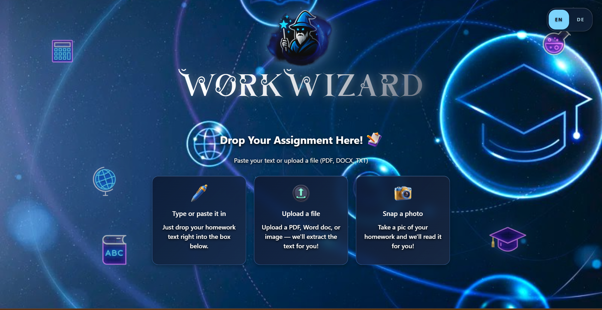
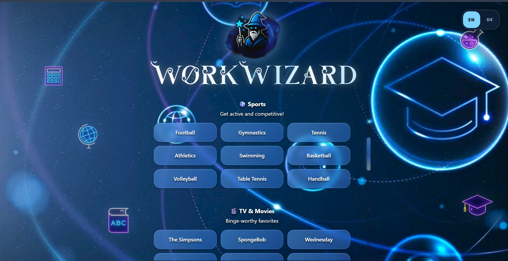
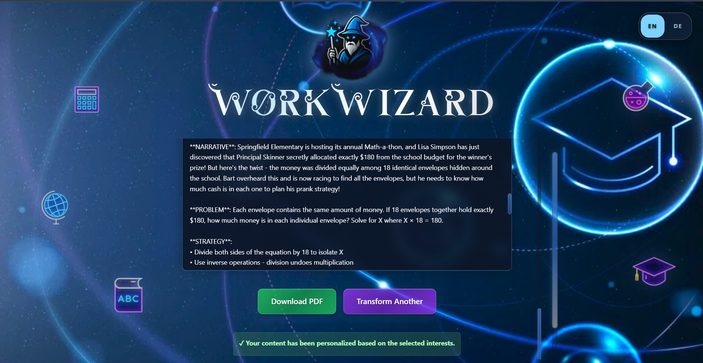

<div align="center">

<a href="https://github.com/Made-in-Jurgistan/workwizard-public">
  
</a>

<br />


<br />

<p align="right">
  
</p>

<p>
  <strong>Worksheets rewritten around what each student cares about</strong>
</p>

<p>
  A worksheet is uploaded, each student picks the topics they love, and every exercise is rewritten<br />
  around them. The learning goal stays the same, the answers stay hidden, and the result is printed.
</p>

<p>
  <a href="https://github.com/Made-in-Jurgistan/workwizard-public/actions/workflows/ci.yml"></a>
  <a href="https://python.org"></a>
  <a href="https://react.dev"></a>
  <a href="https://fastapi.tiangolo.com"></a>
  <a href="LICENSE.md"></a>
</p>

<p>
  Survey: <a href="https://workwizard-demo.vercel.app/survey">workwizard-demo.vercel.app/survey</a>
</p>

</div>

<br />

<div align="center">

| Upload | Choose interests | Personalised exercise |
| :---: | :---: | :---: |
|  |  |  |
| PDF, Word file or photo | 54 interests, no account needed | Same goal, answers hidden |

</div>

<br />

## Contents

- [Why WorkWizard](#why-workwizard)
- [How it works](#how-it-works)
- [Features](#features)
- [Which worksheets it takes](#which-worksheets-it-takes)
- [The research behind it](#the-research-behind-it)
- [Architecture](#architecture)
- [API](#api)
- [Security](#security)
- [Documentation](#documentation)
- [Contributing](#contributing)
- [License](#license)

> **About this repository:** This is WorkWizard's public repository. It holds documentation, brand assets and research papers. The source code and internal documentation are kept in a separate private repository.

## Why WorkWizard

Children learn a lot of what sticks while they practise, and practice is often where they switch off. A teacher can't write a Minecraft version of a geometry sheet for one child and a Marvel version for another, so the whole class gets the same page.

WorkWizard does that rewriting for any worksheet: work in class, homework or test preparation. It takes the worksheet the teacher already uses and rewrites each exercise around an interest the student picked. Software checks that each rewritten exercise still asks for the same thing and doesn't give the answer away. The result is a PDF that the teacher can look over and print, and the student works on paper. Whether this makes students more engaged or helps them learn more is not yet known; a school pilot will measure that.

WorkWizard is built for German schools, works in German and English, and adjusts to seven grade bands from grade 1 to grade 13.

> **Status:** MVP version `0.1.0`, live, not yet piloted in a school. The website runs on Vercel and the server on Railway.

## How it works

```text
Upload  ──▶  Choose interests  ──▶  Rewrite  ──▶  Check  ──▶  Print
```

| Step | What happens |
| --- | --- |
| **Upload** | A PDF, Word file, photo or text file is uploaded. Mistral OCR reads PDFs and photos; where data protection rules require it, a self-hosted reader (MinerU) can be used instead. WorkWizard suggests a grade band, which the teacher confirms or changes. |
| **Choose interests** | The student picks up to five of 54 interests in six groups, all available in German and English. |
| **Rewrite** | Kimi K2.6 works through the worksheet in agent sessions, a few tasks at a time. It writes a short situation from the student's interests around each task, keeps the task text, numbers and blanks as printed, and adds up to two strategy hints that don't give the answer away. |
| **Check** | Every rewritten task is checked in code before it is accepted: is the original task intact, is the answer unchanged, has an answer leaked, does the length suit the grade band? A task that never passes keeps its original text. A final check scans the whole worksheet for revealed answers. The teacher sees the original and the personalised version side by side. |
| **Print** | WeasyPrint produces a PDF laid out for the student's grade band, with optional illustrations. The layouts are tested against accessibility guidelines; no compliance is claimed until an independent audit has been done. |

## Features

| Feature | What it means |
| --- | --- |
| **Interests** | 54 interests in six groups (games, sports, TV and film, fantasy and adventure, superheroes, making things), each with its own story kit of roles, missions, settings, events and details in German and English. Some interests are offered only from a certain grade upward. |
| **Grade bands** | Seven grade bands (1–2, 3–4, 5–6, 7–8, 9–10, 11–12 and 13), each with its own sentence and word limits, topics suitable for the age group and PDF layout |
| **Answers stay hidden** | The model that rewrites a task is never given its answer. Code checks that the answer is unchanged and that no output gives a solution away, in German and English. |
| **Checked in code** | A task is printed in its rewritten form only when every check passes; otherwise it is printed as in the original |
| **Variety** | People and story openings vary from task to task, so a worksheet doesn't repeat itself |
| **One language per sheet** | Each worksheet is written entirely in German or entirely in English, never a mix |
| **Accessible PDFs** | Layouts per grade band, tested against [WCAG 2.2](https://www.w3.org/TR/WCAG22/) level AA criteria; no compliance claim without an audit |
| **Made for paper** | The computer is used to make the worksheet; the student works on paper |

## Which worksheets it takes

WorkWizard recognises 14 subject domains with 37 subdomains. Worksheets in mathematics, science, language arts, social studies (geography and economics), world languages, technology, *Sachunterricht* (the German primary-school subject) and mixed subjects are personalised.

Two kinds of worksheet are turned away before any AI model is used:

- **Subjects that gain nothing from a story:** history, civics, physical education, arts, music, and religion and ethics. In grades 1 to 4, history and civics content counts as *Sachunterricht* and is personalised.
- **Sheets that print their answers:** a worksheet that shows answers outside its answer key. A separate answer key is removed before processing.

## The research behind it

<details>
<summary><strong>Show the eight frameworks</strong></summary>
<br />

WorkWizard records eight frameworks from learning science and motivation research on every personalised task. Four shape the story context and four shape the strategy hints.

| Framework | Main source | What it shapes |
| --- | --- | --- |
| Self-determination theory, autonomy support | Ryan & Deci (2000) | The student's own choice of interest carries the task |
| Narrative transportation | Green & Brock (2000) | A setting that draws the student in |
| Prior knowledge | Ausubel (1968) | Linking the task to what the student knows about the interest |
| Cognitive load theory | Sweller (1988) | One idea per step, nothing that distracts from the task |
| Scaffolding | Wood, Bruner & Ross (1976) | Hints that support without solving |
| Zone of proximal development | Vygotsky (1978) | How much help a hint gives at each grade band |
| Worked examples | Sweller (2011) | A hint shows a step, never the answer |
| Metacognition | Flavell (1979) | Prompts to plan an approach and check the result |

The wider research on these and related ideas, with sources and limits, is summarised in the [K-12 frameworks report](docs/research/k12-pedagogical-frameworks.md). These frameworks inform the design. They are not evidence that WorkWizard itself improves results.

</details>

## Architecture

```text
      ┌─────────────┐              ┌─────────────┐              ┌─────────────┐
      │  Frontend   │─────────────▶│   Backend   │─────────────▶│  Supabase   │
      │  React 19   │              │   FastAPI   │              │  Postgres   │
      │  Vite / TS  │              │   uvicorn   │              └─────────────┘
      └─────────────┘              └──────┬──────┘
                                           │
                          ┌────────────────┼────────────────┐
                    ┌─────▼─────┐    ┌─────▼─────┐    ┌─────▼─────┐
                    │  Mistral  │    │ Kimi K2.6 │    │  OpenAI   │
                    │    OCR    │    │ Transform │    │   Image   │
                    └───────────┘    └───────────┘    └───────────┘
```

<details>
<summary><strong>Backend pipeline stages</strong></summary>
<br />

| Stage | Role |
| --- | --- |
| Extraction | Document to structured text (Mistral OCR, MinerU fallback; Word and text files read directly) |
| Grade and language detection | Grade band from readability and vocabulary signals; German or English from the text |
| Story kits | Roles, missions, settings, events and details of the chosen interests from a curated collection |
| Worksheet checks | Sheets that print their answers, and sheets of subjects that gain nothing from a story, are turned away before any model call |
| Personalisation | The worksheet is split into tasks without changing its text; Kimi K2.6 agent sessions rewrite groups of tasks, and every task is checked in code; progress is streamed to the browser |
| Answer guard | The assembled worksheet is scanned for revealed answers |
| PDF generation | WeasyPrint with layouts per grade band; optional illustrations from an OpenAI image model |

</details>

### Tech stack

| Layer | Technology |
| --- | --- |
| Frontend | React 19, TypeScript 5, Vite 7, Tailwind CSS 4, German and English interface |
| Backend | Python 3.12, FastAPI, Pydantic v2 |
| AI | Kimi K2.6 by Moonshot AI (256K context), Mistral OCR, OpenAI GPT Image 1.5 Mini (PDF illustrations) |
| Data | Supabase Postgres |
| Testing | pytest (5,900+ tests), Vitest (700+ tests) and Playwright (3 specs) |
| Infrastructure | Docker, GitHub Actions, Vercel, Railway |

## API

Application routes are mounted under `/api/v1/...`.

| Method | Endpoint | Description |
| --- | --- | --- |
| `GET` | `/healthz` | Liveness |
| `GET` | `/readyz` | Readiness |
| `GET` | `/health` | Service and dependency diagnostics |
| `POST` | `/api/v1/upload` | Upload PDF, DOCX, TXT or image (max 10 MB) |
| `GET` | `/api/v1/interests/catalog` | Interest catalog |
| `POST` | `/api/v1/ai-transformation/transform` | Personalise a worksheet |
| `POST` | `/api/v1/ai-transformation/transform/stream` | Personalise a worksheet with streamed progress |
| `POST` | `/api/v1/pdf/generate` | Generate a PDF |
| `GET` | `/api/v1/pdf/download/{cache_key}` | Download a generated PDF |
| `POST` | `/api/v1/survey/submit` | Submit an anonymous survey response |
| `POST` | `/api/v1/survey/event` | Record an anonymous survey funnel event |
| `GET` | `/api/v1/survey/peers` | How other respondents in the same role answered, shown from 30 responses per role |

Survey administration, including erasure of one respondent's data, is limited to admin-token holders.

## Security

- Credentials only in environment variables; no secrets in source
- Per-IP rate limiting on upload, transform, PDF, interest and survey routes
- Explicit CORS allowlist, no wildcard origin
- Pydantic v2 validation at every request boundary; uploaded worksheet text is sanitised before it reaches a model
- Non-root containers and digest-pinned base images
- Static security analysis (bandit) and dependency audits on every CI run
- Request time limits so workers can't be tied up (about 280 s for normal requests; longer for streamed progress on large worksheets)
- Survey: no IP address or user agent stored, contact details only with recorded consent, erasure of one respondent's data on request, 18-month retention
- No user accounts in v0.1.0; the pilot will run with teachers supervising access

See [SECURITY.md](SECURITY.md) for the full security policy.

## Documentation

- [Architecture overview](ARCHITECTURE.md): system design and tech stack
- [Security policy](SECURITY.md): security approach and how to report a vulnerability
- [Contributing guidelines](CONTRIBUTING.md): bug reports, suggestions and the survey
- [Research library](docs/research/README.md): index of the public research documents
- [K–12 pedagogical, psychological and engagement frameworks](docs/research/k12-pedagogical-frameworks.md): what learning science says about good worksheets, with sources
- [WorkWizard Research Foundation](docs/research/workwizard-research-foundation.md): the evidence behind the product
- [Press kit](PRESS_KIT.md): boilerplate text, fact sheet, screenshots, brand assets and press FAQ

## Contributing

WorkWizard is proprietary and doesn't accept outside code contributions. Bug reports and suggestions are welcome through [GitHub Issues](https://github.com/Made-in-Jurgistan/workwizard-public/issues), and anyone can give feedback through the survey at [workwizard-demo.vercel.app/survey](https://workwizard-demo.vercel.app/survey).

See [CONTRIBUTING.md](CONTRIBUTING.md) for details.

## License

This software is proprietary and all rights are reserved by the copyright holder. Copying, modifying, distributing or commercially using any part of this repository without permission is not allowed. For licensing questions, email **madeinjurgistan@gmail.com**.

The full terms are in [LICENSE.md](LICENSE.md).

<div align="center">

<sub>Copyright © 2025–2026 Made in Jurgistan. All rights reserved.</sub>

<br />


</div>
